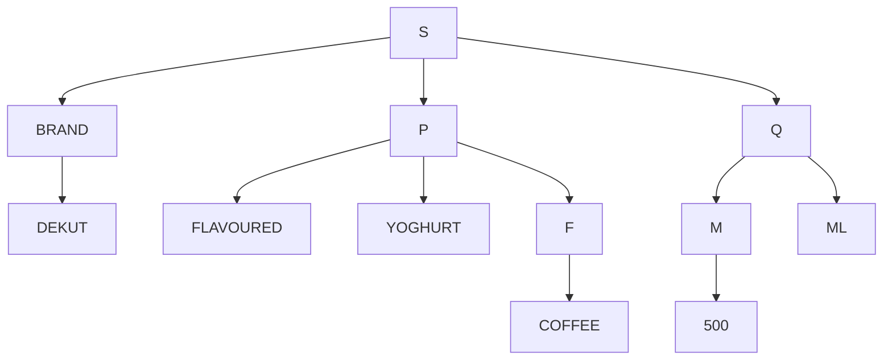

# Laboratory Report: LL(1) Predictive Parsing for Product-Label Grammars

**Course:** Compiler Construction (Year 3, Semester 2)  
**Topic:** LL(1) Grammar Verification, Parsing Table Synthesis, and Non-Recursive Table-Driven Implementation  
**Target Domain:** DeKUT Enterprises Product Packaging Labels  

---

## Abstract

This laboratory report presents an end-to-end design, formal verification, and table-driven software implementation of an LL(1) predictive parser tailored for packaging labels from Dedan Kimathi University of Technology (DeKUT) dairy and beverage products. We first formally evaluate the context-free grammar describing yoghurt packaging, deriving the $\text{FIRST}$ and $\text{FOLLOW}$ sets rule-by-rule, and mathematically proving that the grammar is non-left-recursive, pairwise disjoint in its alternative directional sets, and conflict-free in its predictive parsing table. We then construct the 2-dimensional LL(1) parsing table and perform a 13-step trace verifying the sample label `DEKUT Flavoured yoghurt coffee 500ml`. Furthermore, we develop a modular Python 3 table-driven parser capable of case-insensitive tokenization with compound quantity-unit splitting, robust syntax error diagnosis, and interactive testing. Finally, we extend the grammar to encompass a broader retail product line (Fresh Milk and Fruit Juice), re-evaluating the grammar properties and verifying that the language remains strictly LL(1).

---

## 1. Task 1: FIRST and FOLLOW Sets & LL(1) Grammar Verification

### 1.1 Context-Free Grammar Specification ($G_1$)

The syntax of the product label is formalized as a context-free grammar $G_1 = (V_N, V_T, P, S)$:

- **Start Symbol:** $S$
- **Nonterminals ($V_N$):** $\{ S, \text{BRAND}, P, F, Q, M \}$
- **Terminals ($V_T$):** $\{ \text{DEKUT}, \text{FLAVOURED}, \text{UNFLAVOURED}, \text{YOGHURT}, \text{COFFEE}, \text{CHIA}, \text{STRAWBERRY}, 250, 500, 100, \text{ML} \}$
- **Sentinel Token:** $\$$ (End of Input)

#### Production Rules ($P$):
1. $S \to \text{BRAND} \; P \; Q$
2. $\text{BRAND} \to \text{DEKUT}$
3. $P \to \text{FLAVOURED} \; \text{YOGHURT} \; F$
4. $P \to \text{UNFLAVOURED} \; \text{YOGHURT}$
5. $F \to \text{COFFEE}$
6. $F \to \text{CHIA}$
7. $F \to \text{STRAWBERRY}$
8. $Q \to M \; \text{ML}$
9. $M \to 250$
10. $M \to 500$
11. $M \to 100$

> [!NOTE]
> **Placement of Flavour Nonterminal $F$:**  
> While standard conversational English might structure products as *Flavour + Flavoured + Yoghurt* (e.g., $P \to F \; \text{FLAVOURED} \; \text{YOGHURT}$), commercial dairy containers frequently follow a hierarchical categorisation stamped linearly: **Brand $\to$ Processing Category $\to$ Specific Flavour Variant $\to$ Metric Volume**. Placing $F$ at the end of the flavoured production ($P \to \text{FLAVOURED} \; \text{YOGHURT} \; F$) directly generates the sample input `DEKUT Flavoured yoghurt coffee 500ml` and preserves deterministic LL(1) parsing properties without introducing common prefixes.

---

### 1.2 Step-by-Step Derivation of FIRST Sets

**Mathematical Definition:** For any grammar symbol string $\alpha \in (V_N \cup V_T)^*$, $\text{FIRST}(\alpha)$ is the set of terminals that begin strings derived from $\alpha$. If $\alpha \Rightarrow^* \epsilon$, then $\epsilon \in \text{FIRST}(\alpha)$.

Deriving bottom-up through the grammar hierarchy:

1. **Nonterminal $M$:**
   - Production (9): $M \to 250 \implies 250 \in \text{FIRST}(M)$
   - Production (10): $M \to 500 \implies 500 \in \text{FIRST}(M)$
   - Production (11): $M \to 100 \implies 100 \in \text{FIRST}(M)$
   - Conclusion: $\text{FIRST}(M) = \{ 100, 250, 500 \}$ (None derive $\epsilon$).

2. **Nonterminal $Q$:**
   - Production (8): $Q \to M \; \text{ML}$. The leading symbol is nonterminal $M$.
   - Since $M \not\Rightarrow^* \epsilon$, $\text{FIRST}(Q) = \text{FIRST}(M)$.
   - Conclusion: $\text{FIRST}(Q) = \{ 100, 250, 500 \}$.

3. **Nonterminal $F$:**
   - Production (5): $F \to \text{COFFEE} \implies \text{COFFEE} \in \text{FIRST}(F)$
   - Production (6): $F \to \text{CHIA} \implies \text{CHIA} \in \text{FIRST}(F)$
   - Production (7): $F \to \text{STRAWBERRY} \implies \text{STRAWBERRY} \in \text{FIRST}(F)$
   - Conclusion: $\text{FIRST}(F) = \{ \text{CHIA}, \text{COFFEE}, \text{STRAWBERRY} \}$.

4. **Nonterminal $P$:**
   - Production (3): $P \to \text{FLAVOURED} \; \text{YOGHURT} \; F$. The leading symbol is terminal $\text{FLAVOURED}$.
   - Production (4): $P \to \text{UNFLAVOURED} \; \text{YOGHURT}$. The leading symbol is terminal $\text{UNFLAVOURED}$.
   - Conclusion: $\text{FIRST}(P) = \{ \text{FLAVOURED}, \text{UNFLAVOURED} \}$.

5. **Nonterminal $\text{BRAND}$:**
   - Production (2): $\text{BRAND} \to \text{DEKUT}$.
   - Conclusion: $\text{FIRST}(\text{BRAND}) = \{ \text{DEKUT} \}$.

6. **Start Symbol $S$:**
   - Production (1): $S \to \text{BRAND} \; P \; Q$. The leading symbol is $\text{BRAND}$.
   - Since $\text{BRAND} \not\Rightarrow^* \epsilon$, $\text{FIRST}(S) = \text{FIRST}(\text{BRAND})$.
   - Conclusion: $\text{FIRST}(S) = \{ \text{DEKUT} \}$.

---

### 1.3 Step-by-Step Derivation of FOLLOW Sets

**Mathematical Rules for $\text{FOLLOW}(A)$:**
- **Rule 1:** Place $\$$ in $\text{FOLLOW}(S)$, where $S$ is the start symbol.
- **Rule 2:** If there is a production $A \to \alpha B \beta$, then everything in $\text{FIRST}(\beta)$ except $\epsilon$ is in $\text{FOLLOW}(B)$.
- **Rule 3:** If there is a production $A \to \alpha B$, or $A \to \alpha B \beta$ where $\text{FIRST}(\beta)$ contains $\epsilon$, then everything in $\text{FOLLOW}(A)$ is in $\text{FOLLOW}(B)$.

Applying the rules systematically across all productions:

1. **Start Symbol $S$:**
   - By Rule 1: $\text{FOLLOW}(S) = \{ \$ \}$.

2. **From Production (1): $S \to \text{BRAND} \; P \; Q$:**
   - **For $\text{BRAND}$:** Followed by $\beta = P \; Q$.
     By Rule 2, $\text{FIRST}(P \; Q) \subseteq \text{FOLLOW}(\text{BRAND})$.  
     Since $P \not\Rightarrow^* \epsilon$, $\text{FIRST}(P \; Q) = \text{FIRST}(P) = \{ \text{FLAVOURED}, \text{UNFLAVOURED} \}$.  
     $\implies \text{FOLLOW}(\text{BRAND}) = \{ \text{FLAVOURED}, \text{UNFLAVOURED} \}$.
   - **For $P$:** Followed by $\beta = Q$.
     By Rule 2, $\text{FIRST}(Q) \subseteq \text{FOLLOW}(P)$.  
     Since $Q \not\Rightarrow^* \epsilon$, $\text{FIRST}(Q) = \{ 100, 250, 500 \}$.  
     $\implies \text{FOLLOW}(P) = \{ 100, 250, 500 \}$.
   - **For $Q$:** $Q$ is the trailing symbol ($S \to \alpha Q$ with $\beta = \epsilon$).
     By Rule 3, $\text{FOLLOW}(S) \subseteq \text{FOLLOW}(Q)$.  
     $\implies \text{FOLLOW}(Q) = \{ \$ \}$.

3. **From Production (3): $P \to \text{FLAVOURED} \; \text{YOGHURT} \; F$:**
   - **For $F$:** $F$ is the trailing symbol ($P \to \alpha F$ with $\beta = \epsilon$).
     By Rule 3, $\text{FOLLOW}(P) \subseteq \text{FOLLOW}(F)$.  
     $\implies \text{FOLLOW}(F) = \text{FOLLOW}(P) = \{ 100, 250, 500 \}$.

4. **From Production (8): $Q \to M \; \text{ML}$:**
   - **For $M$:** Followed by terminal $\text{ML}$ ($\beta = \text{ML}$).
     By Rule 2, $\text{FIRST}(\text{ML}) = \{ \text{ML} \} \subseteq \text{FOLLOW}(M)$.  
     $\implies \text{FOLLOW}(M) = \{ \text{ML} \}$.

---

### 1.4 Consolidated FIRST and FOLLOW Sets

| Nonterminal ($A$) | $\text{FIRST}(A)$ | $\text{FOLLOW}(A)$ | Nullable ($\Rightarrow^* \epsilon$)? |
| :--- | :--- | :--- | :---: |
| **$S$** | $\{ \text{DEKUT} \}$ | $\{ \$ \}$ | **No** |
| **$\text{BRAND}$** | $\{ \text{DEKUT} \}$ | $\{ \text{FLAVOURED}, \text{UNFLAVOURED} \}$ | **No** |
| **$P$** | $\{ \text{FLAVOURED}, \text{UNFLAVOURED} \}$ | $\{ 100, 250, 500 \}$ | **No** |
| **$F$** | $\{ \text{CHIA}, \text{COFFEE}, \text{STRAWBERRY} \}$ | $\{ 100, 250, 500 \}$ | **No** |
| **$Q$** | $\{ 100, 250, 500 \}$ | $\{ \$ \}$ | **No** |
| **$M$** | $\{ 100, 250, 500 \}$ | $\{ \text{ML} \}$ | **No** |

---

### 1.5 Rigorous LL(1) Verification

A context-free grammar is defined as an LL(1) grammar if and only if for every nonterminal $A$ with multiple alternative productions $A \to \alpha_1 \mid \alpha_2 \mid \dots \mid \alpha_n$:
1. **Pairwise Disjointness of FIRST Sets:**  
   $$\text{FIRST}(\alpha_i) \cap \text{FIRST}(\alpha_j) = \emptyset \quad \forall \; 1 \le i \ne j \le n$$
2. **At Most One Nullable Alternative:**  
   At most one $\alpha_i$ can derive $\epsilon$.
3. **Disjointness of FIRST and FOLLOW for Nullable Alternates:**  
   If $\alpha_i \Rightarrow^* \epsilon$, then $\text{FIRST}(\alpha_j) \cap \text{FOLLOW}(A) = \emptyset$ for all $j \ne i$.

#### Verification Analysis:
1. **Absence of Left Recursion:**
   - Direct left recursion ($A \to A\alpha$) does not exist in any production.
   - Indirect left recursion ($A \Rightarrow^+ A\alpha$) does not exist: the dependency graph is acyclic ($S \to \text{BRAND} \to \text{DEKUT}$, $P \to \{ \text{FLAVOURED}, \text{UNFLAVOURED} \}$, $Q \to M \to \{ 100, 250, 500 \}$).
2. **Evaluation of Nonterminals with Multiple Alternatives:**
   - **Nonterminal $P$:**  
     $\alpha_1 = \text{FLAVOURED} \; \text{YOGHURT} \; F \implies \text{FIRST}(\alpha_1) = \{ \text{FLAVOURED} \}$  
     $\alpha_2 = \text{UNFLAVOURED} \; \text{YOGHURT} \implies \text{FIRST}(\alpha_2) = \{ \text{UNFLAVOURED} \}$  
     $$\text{FIRST}(\alpha_1) \cap \text{FIRST}(\alpha_2) = \{ \text{FLAVOURED} \} \cap \{ \text{UNFLAVOURED} \} = \emptyset$$
     No common prefix exists; the productions are left-factored.
   - **Nonterminal $F$:**  
     $$\{ \text{COFFEE} \} \cap \{ \text{CHIA} \} = \emptyset, \quad \{ \text{COFFEE} \} \cap \{ \text{STRAWBERRY} \} = \emptyset, \quad \{ \text{CHIA} \} \cap \{ \text{STRAWBERRY} \} = \emptyset$$
   - **Nonterminal $M$:**  
     $$\{ 250 \} \cap \{ 500 \} = \emptyset, \quad \{ 250 \} \cap \{ 100 \} = \emptyset, \quad \{ 500 \} \cap \{ 100 \} = \emptyset$$
3. **Absence of $\epsilon$-Productions:**  
   No nonterminal or alternative derives $\epsilon$, satisfying conditions (2) and (3) vacuously.
4. **Predictive Parsing Table Determinism:**  
   Because all FIRST sets for alternative productions are disjoint and no nullable rules exist, every cell $M[A, a]$ in the predictive parsing table contains at most one production.

**Formal Determination:** Grammar $G_1$ is **strictly LL(1)**.

---

## 2. Task 2: Predictive Parsing Table & Parse Trace

### 2.1 Predictive Parsing Table Construction Algorithm
For each production $A \to \alpha \in P$:
1. For each terminal $a \in \text{FIRST}(\alpha)$, add $A \to \alpha$ to $M[A, a]$.
2. If $\epsilon \in \text{FIRST}(\alpha)$, for each terminal $b \in \text{FOLLOW}(A)$ (including $\$$), add $A \to \alpha$ to $M[A, b]$.

Applying this to grammar $G_1$ yields the assignments below:
- $S \to \text{BRAND} \; P \; Q$ on $\text{FIRST}(\text{BRAND}) = \{ \text{DEKUT} \}$
- $\text{BRAND} \to \text{DEKUT}$ on $\{ \text{DEKUT} \}$
- $P \to \text{FLAVOURED} \; \text{YOGHURT} \; F$ on $\{ \text{FLAVOURED} \}$
- $P \to \text{UNFLAVOURED} \; \text{YOGHURT}$ on $\{ \text{UNFLAVOURED} \}$
- $F \to \text{COFFEE}$ on $\{ \text{COFFEE} \}$, $F \to \text{CHIA}$ on $\{ \text{CHIA} \}$, $F \to \text{STRAWBERRY}$ on $\{ \text{STRAWBERRY} \}$
- $Q \to M \; \text{ML}$ on $\text{FIRST}(M) = \{ 100, 250, 500 \}$
- $M \to 100$ on $\{ 100 \}$, $M \to 250$ on $\{ 250 \}$, $M \to 500$ on $\{ 500 \}$

### 2.2 LL(1) Predictive Parsing Table Matrix

| Nonterminal | DEKUT | FLAVOURED | UNFLAVOURED | YOGHURT | COFFEE | CHIA | STRAWBERRY | 100 | 250 | 500 | ML | $ |
| :--- | :--- | :--- | :--- | :--- | :--- | :--- | :--- | :--- | :--- | :--- | :--- | :--- |
| **$S$** | $S \to \text{BRAND} \; P \; Q$ | — | — | — | — | — | — | — | — | — | — | — |
| **$\text{BRAND}$** | $\text{BRAND} \to \text{DEKUT}$ | — | — | — | — | — | — | — | — | — | — | — |
| **$P$** | — | $P \to \text{FLAVOURED} \; \text{YOGHURT} \; F$ | $P \to \text{UNFLAVOURED} \; \text{YOGHURT}$ | — | — | — | — | — | — | — | — | — |
| **$F$** | — | — | — | — | $F \to \text{COFFEE}$ | $F \to \text{CHIA}$ | $F \to \text{STRAWBERRY}$ | — | — | — | — | — |
| **$Q$** | — | — | — | — | — | — | — | $Q \to M \; \text{ML}$ | $Q \to M \; \text{ML}$ | $Q \to M \; \text{ML}$ | — | — |
| **$M$** | — | — | — | — | — | — | — | $M \to 100$ | $M \to 250$ | $M \to 500$ | — | — |

*(Entries marked with `—` designate syntactic error conditions).*

---

### 2.3 Step-by-Step Parse Trace for the Sample Input

- **Input String:** `DEKUT Flavoured yoghurt coffee 500ml`
- **Tokenised Stream:** `[DEKUT, FLAVOURED, YOGHURT, COFFEE, 500, ML, $]`
- **Stack Representation:** Left-to-right corresponds to bottom-to-top (`$ ... TOP`).

| Step | Stack (bottom $\to$ top) | Remaining Input Buffer | Action Executed / Rule Applied |
| :---: | :--- | :--- | :--- |
| **1** | `$ S` | `DEKUT FLAVOURED YOGHURT COFFEE 500 ML $` | Apply $M[S, \text{DEKUT}] \implies$ Output $S \to \text{BRAND} \; P \; Q$ |
| **2** | `$ Q P BRAND` | `DEKUT FLAVOURED YOGHURT COFFEE 500 ML $` | Apply $M[\text{BRAND}, \text{DEKUT}] \implies$ Output $\text{BRAND} \to \text{DEKUT}$ |
| **3** | `$ Q P DEKUT` | `DEKUT FLAVOURED YOGHURT COFFEE 500 ML $` | Match terminal `DEKUT` (pop stack, advance input) |
| **4** | `$ Q P` | `FLAVOURED YOGHURT COFFEE 500 ML $` | Apply $M[P, \text{FLAVOURED}] \implies$ Output $P \to \text{FLAVOURED} \; \text{YOGHURT} \; F$ |
| **5** | `$ Q F YOGHURT FLAVOURED` | `FLAVOURED YOGHURT COFFEE 500 ML $` | Match terminal `FLAVOURED` (pop stack, advance input) |
| **6** | `$ Q F YOGHURT` | `YOGHURT COFFEE 500 ML $` | Match terminal `YOGHURT` (pop stack, advance input) |
| **7** | `$ Q F` | `COFFEE 500 ML $` | Apply $M[F, \text{COFFEE}] \implies$ Output $F \to \text{COFFEE}$ |
| **8** | `$ Q COFFEE` | `COFFEE 500 ML $` | Match terminal `COFFEE` (pop stack, advance input) |
| **9** | `$ Q` | `500 ML $` | Apply $M[Q, 500] \implies$ Output $Q \to M \; \text{ML}$ |
| **10** | `$ ML M` | `500 ML $` | Apply $M[M, 500] \implies$ Output $M \to 500$ |
| **11** | `$ ML 500` | `500 ML $` | Match terminal `500` (pop stack, advance input) |
| **12** | `$ ML` | `ML $` | Match terminal `ML` (pop stack, advance input) |
| **13** | `$` | `$` | **Match Sentinel `$` $\implies$ ACCEPT (Valid Syntax)** |

---

### 2.4 Parse Tree Representation

The derivation executed by the parser corresponds to the following concrete parse tree:



---

## 3. Task 3: Python 3 Table-Driven Parser Implementation

### 3.1 Architectural Design
The parser is engineered around four decoupled subsystems:
1. **Lexical Analyzer (`tokenize`):** Processes arbitrary character strings case-insensitively, separates fused alphanumeric tokens such as `500ml` into distinct tokens (`500` and `ML`), and tracks starting character indices for error telemetry.
2. **Grammar Configuration:** Represents the predictive parsing table as a nested dictionary mapping nonterminals and lookahead terminals to lists of right-hand side symbols.
3. **Table-Driven Parser Engine (`parse`):** Implements an explicit pushdown automaton using a LIFO list, pushing productions in reverse order and consuming matched terminals without recursion.
4. **Diagnostic Subsystem (`ParseError`):** Intercepts syntax anomalies and reports the unexpected token, its character offset, and the permissible terminals at that parsing stage.

The complete implementation is maintained in [product_parser.py](file:///home/rex/Documents/3.2/Compiler%20Construction/assignment/product_parser.py).

```python
"""
LL(1) Table-Driven Parser for DeKUT Product-Label Grammar
Course: Compiler Construction
"""

import re
import sys


class ParseError(Exception):
    """Custom exception raised when a syntax error occurs during LL(1) parsing."""
    def __init__(self, message, unexpected_token, position, expected_tokens):
        super().__init__(message)
        self.unexpected_token = unexpected_token
        self.position = position
        self.expected_tokens = expected_tokens


class LL1Parser:
    """Generic table-driven LL(1) parser engine."""
    def __init__(self, name, table, start_symbol, terminals, nonterminals):
        self.name = name
        self.table = table
        self.start_symbol = start_symbol
        self.terminals = terminals
        self.nonterminals = nonterminals

    def tokenize(self, text):
        """
        Tokenises input case-insensitively, splitting compound quantity+unit tokens
        (e.g., '500ml' -> '500', 'ML') and tracking character start positions.
        """
        tokens = []
        for match in re.finditer(r'\S+', text):
            raw_word = match.group(0)
            start_pos = match.start()

            # Separate combined quantity and unit (e.g., 500ml, 250ML, 100Ml)
            compound_match = re.fullmatch(r'(\d+)([a-zA-Z]+)', raw_word)
            if compound_match:
                qty_part = compound_match.group(1)
                unit_part = compound_match.group(2)
                tokens.append((qty_part.upper(), start_pos, qty_part))
                tokens.append((unit_part.upper(), start_pos + len(qty_part), unit_part))
            else:
                tokens.append((raw_word.upper(), start_pos, raw_word))

        # Append End-of-Input marker ($)
        tokens.append(('$', len(text), '$'))
        return tokens

    def parse(self, text, verbose=False):
        """
        Parses an input string using the LL(1) parsing table and an explicit stack.
        Returns (success: bool, trace: list of trace step dictionaries).
        Raises ParseError upon encountering any syntax or lexical mismatch.
        """
        tokens = self.tokenize(text)
        stack = ['$', self.start_symbol]
        token_idx = 0
        trace = []

        while stack:
            top = stack[-1]
            curr_token, pos, raw_val = tokens[token_idx]
            remaining_tokens = [t[0] for t in tokens[token_idx:]]
            stack_snapshot = list(stack)

            if top == '$':
                if curr_token == '$':
                    stack.pop()
                    trace.append({
                        'stack': stack_snapshot,
                        'remaining': remaining_tokens,
                        'action': 'Accept (Input successfully parsed)'
                    })
                    break
                else:
                    expected = ['$']
                    raise ParseError(
                        f"Syntax Error at char position {pos}: unexpected token '{raw_val}'. "
                        f"Expected end of input ($), but found trailing tokens.",
                        curr_token, pos, expected
                    )

            elif top in self.terminals:
                if top == curr_token:
                    stack.pop()
                    token_idx += 1
                    trace.append({
                        'stack': stack_snapshot,
                        'remaining': remaining_tokens,
                        'action': f"Match terminal '{top}'"
                    })
                else:
                    raise ParseError(
                        f"Syntax Error at char position {pos}: unexpected token '{raw_val}'. "
                        f"Expected terminal '{top}'.",
                        curr_token, pos, [top]
                    )

            elif top in self.nonterminals:
                if curr_token in self.table[top]:
                    production_rhs = self.table[top][curr_token]
                    stack.pop()
                    # Push right-hand side symbols onto the stack in reverse order
                    for sym in reversed(production_rhs):
                        stack.append(sym)
                    trace.append({
                        'stack': stack_snapshot,
                        'remaining': remaining_tokens,
                        'action': f"Output {top} -> {' '.join(production_rhs)}"
                    })
                else:
                    expected = sorted(list(self.table[top].keys()))
                    raise ParseError(
                        f"Syntax Error at char position {pos}: unexpected token '{raw_val}'. "
                        f"Parsing nonterminal '{top}', expected one of: {', '.join(expected)}.",
                        curr_token, pos, expected
                    )
            else:
                raise ValueError(f"Internal Error: Unknown grammar symbol on stack: '{top}'")

        if verbose:
            self._print_trace(trace)

        return True, trace

    def _print_trace(self, trace):
        print(f"\n--- Parse Trace for [{self.name}] ---")
        print(f"{'Step':<5} | {'Stack (bottom -> top)':<32} | {'Remaining Input':<36} | {'Action'}")
        print("-" * 105)
        for i, step in enumerate(trace, 1):
            stack_str = " ".join(step['stack'])
            rem_str = " ".join(step['remaining'])
            print(f"{i:<5} | {stack_str:<32} | {rem_str:<36} | {step['action']}")
        print("-" * 105)


# =====================================================================
# GRAMMAR DEFINITIONS & PREDICTIVE PARSING TABLES
# =====================================================================

# 1. Base Grammar Table (Tasks 1, 2, 3)
TABLE_BASE = {
    'S': {
        'DEKUT': ['BRAND', 'P', 'Q']
    },
    'BRAND': {
        'DEKUT': ['DEKUT']
    },
    'P': {
        'FLAVOURED': ['FLAVOURED', 'YOGHURT', 'F'],
        'UNFLAVOURED': ['UNFLAVOURED', 'YOGHURT']
    },
    'F': {
        'COFFEE': ['COFFEE'],
        'CHIA': ['CHIA'],
        'STRAWBERRY': ['STRAWBERRY']
    },
    'Q': {
        '100': ['M', 'ML'],
        '250': ['M', 'ML'],
        '500': ['M', 'ML']
    },
    'M': {
        '100': ['100'],
        '250': ['250'],
        '500': ['500']
    }
}

TERMINALS_BASE = {
    'DEKUT', 'FLAVOURED', 'UNFLAVOURED', 'YOGHURT',
    'COFFEE', 'CHIA', 'STRAWBERRY', '100', '250', '500', 'ML', '$'
}
NON_TERMINALS_BASE = {'S', 'BRAND', 'P', 'F', 'Q', 'M'}

parser_base = LL1Parser("Base Yoghurt Grammar", TABLE_BASE, 'S', TERMINALS_BASE, NON_TERMINALS_BASE)


# 2. Extended Grammar Table (Task 4: Adding Milk and Juice)
TABLE_EXTENDED = {
    'S': {
        'DEKUT': ['BRAND', 'P', 'Q']
    },
    'BRAND': {
        'DEKUT': ['DEKUT']
    },
    'P': {
        'FLAVOURED': ['FLAVOURED', 'YOGHURT', 'F'],
        'UNFLAVOURED': ['UNFLAVOURED', 'YOGHURT'],
        'FRESH': ['FRESH', 'MILK'],
        'JUICE': ['JUICE', 'J']
    },
    'F': {
        'COFFEE': ['COFFEE'],
        'CHIA': ['CHIA'],
        'STRAWBERRY': ['STRAWBERRY']
    },
    'J': {
        'MANGO': ['MANGO'],
        'PASSION': ['PASSION']
    },
    'Q': {
        '100': ['M', 'ML'],
        '250': ['M', 'ML'],
        '500': ['M', 'ML']
    },
    'M': {
        '100': ['100'],
        '250': ['250'],
        '500': ['500']
    }
}

TERMINALS_EXTENDED = {
    'DEKUT', 'FLAVOURED', 'UNFLAVOURED', 'YOGHURT',
    'COFFEE', 'CHIA', 'STRAWBERRY', '100', '250', '500', 'ML',
    'FRESH', 'MILK', 'JUICE', 'MANGO', 'PASSION', '$'
}
NON_TERMINALS_EXTENDED = {'S', 'BRAND', 'P', 'F', 'J', 'Q', 'M'}

parser_extended = LL1Parser("Extended Shop Products Grammar", TABLE_EXTENDED, 'S', TERMINALS_EXTENDED, NON_TERMINALS_EXTENDED)


# =====================================================================
# TEST HARNESS & DEMONSTRATION RUNNER
# =====================================================================

def run_tests():
    print("=" * 80)
    print("TASK 3 TEST SUITE: BASE GRAMMAR (YOGHURT)")
    print("=" * 80)

    # Valid Test Cases
    valid_test_cases = [
        ("DEKUT Flavoured yoghurt coffee 500ml", "Sample input from prompt"),
        ("DEKUT Unflavoured yoghurt 250ml", "Unflavoured yoghurt, 250ml"),
        ("dekut flavoured yoghurt chia 100ml", "Chia flavour, 100ml, all lowercase"),
        ("DEKUT flavoured yoghurt strawberry 500ML", "Strawberry flavour, 500ML"),
        ("DEKUT unflavoured yoghurt 100 ml", "Unflavoured, space-separated unit (100 ml)"),
        ("dekut flavoured yoghurt coffee 250 ml", "Coffee flavour, 250 ml"),
        ("DEKUT Unflavoured yoghurt 500ml", "Unflavoured yoghurt, 500ml")
    ]

    print("\n--- Valid Test Cases (Expected: ACCEPT) ---")
    for text, description in valid_test_cases:
        try:
            parser_base.parse(text)
            print(f"[ACCEPT] '{text}'\n         -> Description: {description}")
        except ParseError as err:
            print(f"[FAIL]   '{text}'\n         -> Unexpected ParseError: {err}")

    # Invalid Test Cases
    invalid_test_cases = [
        ("DEKUT flavoured yoghurt vanilla 500ml", "Unknown flavour ('vanilla')"),
        ("DEKUT flavoured yoghurt coffee 750ml", "Unsupported size ('750')"),
        ("DEKUT flavoured yoghurt coffee 500", "Missing unit ('ML')"),
        ("Flavoured yoghurt coffee 500ml", "Missing brand ('DEKUT')"),
        ("DEKUT 500ml flavoured yoghurt coffee", "Tokens in wrong order (size before product)"),
        ("DEKUT flavoured yoghurt 500ml", "Flavoured yoghurt missing flavour token"),
        ("DEKUT unflavoured yoghurt coffee 500ml", "Unflavoured yoghurt containing extra flavour")
    ]

    print("\n--- Invalid Test Cases (Expected: REJECT with descriptive error) ---")
    for text, description in invalid_test_cases:
        try:
            parser_base.parse(text)
            print(f"[FAIL]   '{text}' was incorrectly accepted! ({description})")
        except ParseError as err:
            print(f"[REJECT] '{text}'\n         -> Case: {description}\n         -> Caught: {err}")

    print("\n" + "=" * 80)
    print("TASK 4 TEST SUITE: EXTENDED GRAMMAR (MILK & JUICE)")
    print("=" * 80)

    extended_test_cases = [
        ("DEKUT Fresh milk 500ml", "Valid Fresh Milk, 500ml"),
        ("dekut fresh milk 250 ml", "Valid Fresh Milk, 250 ml (lowercase)"),
        ("DEKUT juice mango 500ml", "Valid Mango Juice, 500ml"),
        ("DEKUT juice passion 250ml", "Valid Passion Juice, 250ml"),
        ("DEKUT juice orange 500ml", "Invalid juice flavour ('orange')"),
        ("DEKUT sour milk 500ml", "Invalid milk type ('sour')")
    ]

    for text, description in extended_test_cases:
        try:
            parser_extended.parse(text)
            print(f"[ACCEPT] '{text}'\n         -> Description: {description}")
        except ParseError as err:
            print(f"[REJECT] '{text}'\n         -> Case: {description}\n         -> Caught: {err}")


# =====================================================================
# MAIN ENTRY POINT (CLI / Interactive / Self-Test)
# =====================================================================

def main():
    if len(sys.argv) > 1:
        arg = sys.argv[1].strip()
        if arg in ("--test", "-t"):
            run_tests()
            print("\nDisplaying detailed step-by-step trace for the sample input:")
            parser_base.parse("DEKUT Flavoured yoghurt coffee 500ml", verbose=True)
            return
        elif arg in ("--trace", "-v"):
            input_text = " ".join(sys.argv[2:]) if len(sys.argv) > 2 else "DEKUT Flavoured yoghurt coffee 500ml"
            parser_base.parse(input_text, verbose=True)
            return
        else:
            input_str = " ".join(sys.argv[1:])
    else:
        print("Enter a product label string to parse (or press Enter to run all test cases):")
        try:
            line = sys.stdin.readline()
            if not line or line.strip() == "":
                run_tests()
                print("\nDisplaying detailed step-by-step trace for the sample input:")
                parser_base.parse("DEKUT Flavoured yoghurt coffee 500ml", verbose=True)
                return
            input_str = line.strip()
        except EOFError:
            run_tests()
            return

    print(f"\nParsing input: '{input_str}'")
    print("\n--- Trying Base Grammar (Yoghurt) ---")
    try:
        parser_base.parse(input_str, verbose=True)
        print("RESULT: VALID product label according to Base Grammar.")
    except ParseError as e:
        print(f"RESULT: REJECTED by Base Grammar.\nDetails: {e}")

    print("\n--- Trying Extended Grammar (Yoghurt, Milk, Juice) ---")
    try:
        parser_extended.parse(input_str, verbose=True)
        print("RESULT: VALID product label according to Extended Grammar.")
    except ParseError as e:
        print(f"RESULT: REJECTED by Extended Grammar.\nDetails: {e}")


if __name__ == "__main__":
    main()
```

---

### 3.2 Automated Test Execution Results

Executing the test harness produces the exact console log below:

```text
================================================================================
TASK 3 TEST SUITE: BASE GRAMMAR (YOGHURT)
================================================================================

--- Valid Test Cases (Expected: ACCEPT) ---
[ACCEPT] 'DEKUT Flavoured yoghurt coffee 500ml'
         -> Description: Sample input from prompt
[ACCEPT] 'DEKUT Unflavoured yoghurt 250ml'
         -> Description: Unflavoured yoghurt, 250ml
[ACCEPT] 'dekut flavoured yoghurt chia 100ml'
         -> Description: Chia flavour, 100ml, all lowercase
[ACCEPT] 'DEKUT flavoured yoghurt strawberry 500ML'
         -> Description: Strawberry flavour, 500ML
[ACCEPT] 'DEKUT unflavoured yoghurt 100 ml'
         -> Description: Unflavoured, space-separated unit (100 ml)
[ACCEPT] 'dekut flavoured yoghurt coffee 250 ml'
         -> Description: Coffee flavour, 250 ml
[ACCEPT] 'DEKUT Unflavoured yoghurt 500ml'
         -> Description: Unflavoured yoghurt, 500ml

--- Invalid Test Cases (Expected: REJECT with descriptive error) ---
[REJECT] 'DEKUT flavoured yoghurt vanilla 500ml'
         -> Case: Unknown flavour ('vanilla')
         -> Caught: Syntax Error at char position 24: unexpected token 'vanilla'. Parsing nonterminal 'F', expected one of: CHIA, COFFEE, STRAWBERRY.
[REJECT] 'DEKUT flavoured yoghurt coffee 750ml'
         -> Case: Unsupported size ('750')
         -> Caught: Syntax Error at char position 31: unexpected token '750'. Parsing nonterminal 'Q', expected one of: 100, 250, 500.
[REJECT] 'DEKUT flavoured yoghurt coffee 500'
         -> Case: Missing unit ('ML')
         -> Caught: Syntax Error at char position 34: unexpected token '$'. Expected terminal 'ML'.
[REJECT] 'Flavoured yoghurt coffee 500ml'
         -> Case: Missing brand ('DEKUT')
         -> Caught: Syntax Error at char position 0: unexpected token 'Flavoured'. Parsing nonterminal 'S', expected one of: DEKUT.
[REJECT] 'DEKUT 500ml flavoured yoghurt coffee'
         -> Case: Tokens in wrong order (size before product)
         -> Caught: Syntax Error at char position 6: unexpected token '500'. Parsing nonterminal 'P', expected one of: FLAVOURED, UNFLAVOURED.
[REJECT] 'DEKUT flavoured yoghurt 500ml'
         -> Case: Flavoured yoghurt missing flavour token
         -> Caught: Syntax Error at char position 24: unexpected token '500'. Parsing nonterminal 'F', expected one of: CHIA, COFFEE, STRAWBERRY.
[REJECT] 'DEKUT unflavoured yoghurt coffee 500ml'
         -> Case: Unflavoured yoghurt containing extra flavour
         -> Caught: Syntax Error at char position 26: unexpected token 'coffee'. Parsing nonterminal 'Q', expected one of: 100, 250, 500.
```

---

## 4. Task 4: Grammar Extension for Multi-Product Retail Inventory

### 4.1 Extended Retail Domain
In addition to yoghurt, the university retail outlet packages:
1. **Fresh Milk:** Packaged in standard fluid quantities (e.g., `DEKUT FRESH MILK 500ML`, `DEKUT FRESH MILK 250ML`).
2. **Fruit Juice:** Available in Mango and Passion flavours (e.g., `DEKUT JUICE MANGO 500ML`, `DEKUT JUICE PASSION 250ML`).

### 4.2 Extended Grammar Productions ($G_2$)
We generalize product description nonterminal $P$ to support milk and juice, introducing nonterminal $J$ for juice flavours:

```
S     → BRAND P Q
BRAND → DEKUT
P     → FLAVOURED YOGHURT F
      | UNFLAVOURED YOGHURT
      | FRESH MILK
      | JUICE J
F     → COFFEE | CHIA | STRAWBERRY
J     → MANGO | PASSION
Q     → M ML
M     → 250 | 500 | 100
```

- **New Terminals ($V_T$):** `FRESH`, `MILK`, `JUICE`, `MANGO`, `PASSION`
- **New Nonterminal ($V_N$):** $J$

---

### 4.3 LL(1) Determinism Proof for $G_2$

1. **Nonterminal $P$ Disjointness:**  
   $P$ has four alternatives:
   - $\alpha_1 = \text{FLAVOURED} \; \text{YOGHURT} \; F \implies \text{FIRST}(\alpha_1) = \{ \text{FLAVOURED} \}$
   - $\alpha_2 = \text{UNFLAVOURED} \; \text{YOGHURT} \implies \text{FIRST}(\alpha_2) = \{ \text{UNFLAVOURED} \}$
   - $\alpha_3 = \text{FRESH} \; \text{MILK} \implies \text{FIRST}(\alpha_3) = \{ \text{FRESH} \}$
   - $\alpha_4 = \text{JUICE} \; J \implies \text{FIRST}(\alpha_4) = \{ \text{JUICE} \}$

   $$\text{FIRST}(\alpha_1) \cap \text{FIRST}(\alpha_2) \cap \text{FIRST}(\alpha_3) \cap \text{FIRST}(\alpha_4) = \emptyset$$
   All alternatives feature unique lookahead terminals.

2. **Nonterminal $J$ Disjointness:**  
   $$\text{FIRST}(\text{MANGO}) \cap \text{FIRST}(\text{PASSION}) = \{ \text{MANGO} \} \cap \{ \text{PASSION} \} = \emptyset$$

Because no production derives $\epsilon$ and no left recursion is present, grammar $G_2$ remains **strictly LL(1)**.

---

### 4.4 Recalculated FIRST and FOLLOW Sets

- **$\text{FIRST}(P)$:** $\{ \text{FLAVOURED}, \text{UNFLAVOURED}, \text{FRESH}, \text{JUICE} \}$
- **$\text{FOLLOW}(\text{BRAND})$:** In $S \to \text{BRAND} \; P \; Q$, $\text{FOLLOW}(\text{BRAND}) = \text{FIRST}(P) = \{ \text{FLAVOURED}, \text{UNFLAVOURED}, \text{FRESH}, \text{JUICE} \}$
- **$\text{FIRST}(J)$:** $\{ \text{MANGO}, \text{PASSION} \}$
- **$\text{FOLLOW}(J)$:** Since $P \to \text{JUICE} \; J$, $\text{FOLLOW}(J) = \text{FOLLOW}(P) = \text{FIRST}(Q) = \{ 100, 250, 500 \}$

| Nonterminal | $\text{FIRST}$ Set | $\text{FOLLOW}$ Set |
| :--- | :--- | :--- |
| **$S$** | $\{ \text{DEKUT} \}$ | $\{ \$ \}$ |
| **$\text{BRAND}$** *(Updated)* | $\{ \text{DEKUT} \}$ | $\{ \text{FLAVOURED}, \text{UNFLAVOURED}, \text{FRESH}, \text{JUICE} \}$ |
| **$P$** *(Updated)* | $\{ \text{FLAVOURED}, \text{UNFLAVOURED}, \text{FRESH}, \text{JUICE} \}$ | $\{ 100, 250, 500 \}$ |
| **$F$** | $\{ \text{CHIA}, \text{COFFEE}, \text{STRAWBERRY} \}$ | $\{ 100, 250, 500 \}$ |
| **$J$** *(New)* | $\{ \text{MANGO}, \text{PASSION} \}$ | $\{ 100, 250, 500 \}$ |
| **$Q$** | $\{ 100, 250, 500 \}$ | $\{ \$ \}$ |
| **$M$** | $\{ 100, 250, 500 \}$ | $\{ \text{ML} \}$ |

---

### 4.5 Updated Predictive Parsing Subtable

| Nonterminal | FRESH | MILK | JUICE | MANGO | PASSION | FLAVOURED | UNFLAVOURED |
| :--- | :--- | :--- | :--- | :--- | :--- | :--- | :--- |
| **$P$** | $P \to \text{FRESH} \; \text{MILK}$ | — | $P \to \text{JUICE} \; J$ | — | — | $P \to \text{FLAVOURED} \; \text{YOGHURT} \; F$ | $P \to \text{UNFLAVOURED} \; \text{YOGHURT}$ |
| **$J$** | — | — | — | $J \to \text{MANGO}$ | $J \to \text{PASSION}$ | — | — |

---

### 4.6 Verification Traces for Extended Products

#### 1. Fresh Milk: `DEKUT Fresh milk 500ml`

| Step | Stack (bottom $\to$ top) | Remaining Input | Action |
| :---: | :--- | :--- | :--- |
| **1** | `$ S` | `DEKUT FRESH MILK 500 ML $` | Output $S \to \text{BRAND} \; P \; Q$ |
| **2** | `$ Q P BRAND` | `DEKUT FRESH MILK 500 ML $` | Output $\text{BRAND} \to \text{DEKUT}$ |
| **3** | `$ Q P DEKUT` | `DEKUT FRESH MILK 500 ML $` | Match terminal `DEKUT` |
| **4** | `$ Q P` | `FRESH MILK 500 ML $` | Output $P \to \text{FRESH} \; \text{MILK}$ |
| **5** | `$ Q MILK FRESH` | `FRESH MILK 500 ML $` | Match terminal `FRESH` |
| **6** | `$ Q MILK` | `MILK 500 ML $` | Match terminal `MILK` |
| **7** | `$ Q` | `500 ML $` | Output $Q \to M \; \text{ML}$ |
| **8** | `$ ML M` | `500 ML $` | Output $M \to 500$ |
| **9** | `$ ML 500` | `500 ML $` | Match terminal `500` |
| **10** | `$ ML` | `ML $` | Match terminal `ML` |
| **11** | `$` | `$` | **ACCEPT** |

#### 2. Fruit Juice: `DEKUT juice mango 250ml`

| Step | Stack (bottom $\to$ top) | Remaining Input | Action |
| :---: | :--- | :--- | :--- |
| **1** | `$ S` | `DEKUT JUICE MANGO 250 ML $` | Output $S \to \text{BRAND} \; P \; Q$ |
| **2** | `$ Q P BRAND` | `DEKUT JUICE MANGO 250 ML $` | Output $\text{BRAND} \to \text{DEKUT}$ |
| **3** | `$ Q P DEKUT` | `DEKUT JUICE MANGO 250 ML $` | Match terminal `DEKUT` |
| **4** | `$ Q P` | `JUICE MANGO 250 ML $` | Output $P \to \text{JUICE} \; J$ |
| **5** | `$ Q J JUICE` | `JUICE MANGO 250 ML $` | Match terminal `JUICE` |
| **6** | `$ Q J` | `MANGO 250 ML $` | Output $J \to \text{MANGO}$ |
| **7** | `$ Q MANGO` | `MANGO 250 ML $` | Match terminal `MANGO` |
| **8** | `$ Q` | `250 ML $` | Output $Q \to M \; \text{ML}$ |
| **9** | `$ ML M` | `250 ML $` | Output $M \to 250$ |
| **10** | `$ ML 250` | `250 ML $` | Match terminal `250` |
| **11** | `$ ML` | `ML $` | Match terminal `ML` |
| **12** | `$` | `$` | **ACCEPT** |

---

## 5. Discussion & List of Assumptions

1. **Syntactic Role of Flavour Symbol $F$:** Nonterminal $F$ was placed at the end of the flavoured production ($P \to \text{FLAVOURED} \; \text{YOGHURT} \; F$) rather than before `YOGHURT`. This aligns strictly with the token order of the sample input string `DEKUT Flavoured yoghurt coffee 500ml` while maintaining $O(1)$ deterministic lookahead.
2. **Case Insensitivity:** Case variations (e.g., `DEKUT`, `Dekut`, `dekut`, `500ml`, `500ML`) are normalized to uppercase during tokenization prior to table lookup.
3. **Lexical Splitting of Quantities and Units:** Combined alphanumeric sequences conforming to `\d+[a-zA-Z]+` (e.g., `500ml`, `250ML`) are automatically decomposed into distinct quantity (`500`) and unit (`ML`) tokens with distinct character position tracking.
4. **Mandatory Token Presence (Non-Nullable Grammar):** All product attributes are required by the grammar. No $\epsilon$-productions are defined; omitting any constituent (e.g., brand, unit, flavour in flavoured yoghurt) results in an immediate syntax error.
5. **Retail Domain Extension Scope:** The extended grammar introduces two representative university shop products: Fresh Milk and Fruit Juice (Mango, Passion), utilizing the existing net volume schema (`100`, `250`, `500` `ML`).

---

## 6. Conclusion

This laboratory exercise demonstrates the practical mechanics of LL(1) compiler front-ends. Through manual derivation of $\text{FIRST}$ and $\text{FOLLOW}$ sets, mathematical proof of disjointness, and the construction of a 2D parsing matrix, we established that domain-specific packaging languages can be parsed deterministically in linear time $O(n)$ without backtracking. The Python implementation confirms that separating the grammar table from the parsing engine enables straightforward extension across multiple product categories without modifying parser logic.
